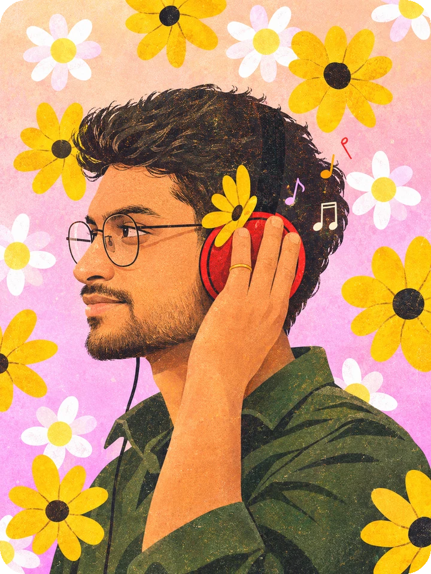

<!-- Contribution snake: generated weekly by .github/workflows/snake.yml (lives on the `output` branch) -->
<picture>
  <source media="(prefers-color-scheme: dark)" srcset="https://raw.githubusercontent.com/rohit-burman/rohit-burman/output/github-snake-dark.svg">
  <source media="(prefers-color-scheme: light)" srcset="https://raw.githubusercontent.com/rohit-burman/rohit-burman/output/github-snake.svg">
  
</picture>

  

 

Final-year Computer Science student who likes building backends that hold up and interfaces people enjoy using.

<!--
  CONTACT LINKS (optional): uncomment and fill in whichever you want shown.
  
  
  
-->

 

### `about`

- 🎓 &nbsp;B.Tech in Computer Science, **Asansol Engineering College** (2023 – 2027)
- 🧩 &nbsp;Web Technologies Lead at **GDGC Asansol Engineering College**, since 2025
- 💼 &nbsp;Frontend Intern at **KomfyTrip** (remote), Jan – Dec 2025
- 🌱 &nbsp;Open to backend, full-stack and SDE roles, happy to relocate anywhere in India
- 📍 &nbsp;Asansol, West Bengal

 

### `building`

<!-- To link a project, wrap its name like: **[PadhAI](https://github.com/rohit-burman/REPO-NAME)** -->

| Project | What it is | Built with |
| :-- | :-- | :-- |
| **PadhAI** | Adaptive AI study planner with a streak-based global leaderboard | FastAPI · PostgreSQL · Redis · Dramatiq · Groq |
| **AyurTrace** | Final-year project: identify medicinal plants and check their health from a photo, with QR and blockchain traceability | MobileNetV2 · FastAPI · Solidity · Ganache |
| **jgrep** | A `grep` that matches by meaning instead of exact text | Go · Python · Laya |

 

### `stack`

  

 

<!-- ▼▼▼ WEEKLY STATS (WakaTime). To remove: delete this whole block AND .github/workflows/waka.yml ▼▼▼ -->

### `lately`

Auto-updated once a week from my editor activity (WakaTime).

<!--START_SECTION:waka-->
<!--END_SECTION:waka-->

 

<!-- ▲▲▲ END WEEKLY STATS ▲▲▲ -->

<picture>
  <source media="(prefers-color-scheme: dark)" srcset="https://readme-jokes.vercel.app/api?hideBorder&bgColor=%23161B22&qColor=%23F06595&aColor=%23FFD43B&textColor=%23C9D1D9&codeColor=%23F06595">
  <source media="(prefers-color-scheme: light)" srcset="https://readme-jokes.vercel.app/api?hideBorder&bgColor=%23FFF6E5&qColor=%23C2255C&aColor=%232F5233&textColor=%23333333&codeColor=%23C2255C">
  
</picture>

↻ refresh for a new joke

